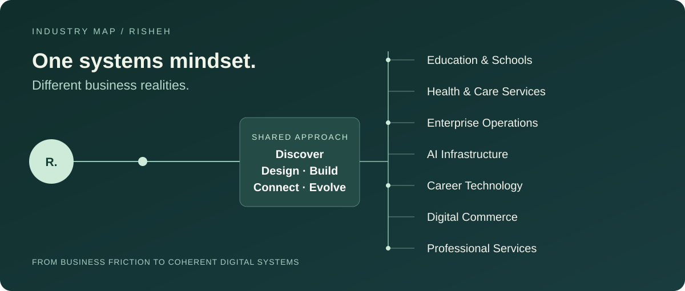

 

**Independent digital systems studio · Strategy × Product × Engineering × Intelligence**

*We design the systems behind sustainable business growth.*

[**Explore the English profile ↗**](./Risheh_Industry_Profile_EN.pdf) &nbsp; · &nbsp; [**مطالعه نسخه فارسی ↗**](./Risheh_Business_Sectors_FA_Ravi.pdf) &nbsp; · &nbsp; [**Visit RISHEH ↗**](https://www.rishehcompany.ir)

 

ENGLISH &nbsp; / &nbsp; فارسی &nbsp; • &nbsp; INDUSTRY-LED PORTFOLIO &nbsp; • &nbsp; 2026

---

### THE POINT OF VIEW

## More software isn't the answer. Better-connected systems are.

A website that doesn't speak to operations. A CRM disconnected from the sales journey. Automation that moves tasks but never improves decisions. Businesses rarely suffer from a shortage of tools; they suffer from a shortage of **coherence**.

At RISHEH, we start with the business problem and work backward toward the right architecture. Strategy shapes experience. Engineering makes it reliable. Data, automation, and AI connect the pieces. The result isn't merely a deliverable—it is a system that can evolve.

 

<table>
<tr><td width="33%" valign="top"><b>01 / UNDERSTAND</b>  Map the business, its people, constraints, and the friction worth removing.</td><td width="33%" valign="top"><b>02 / ENGINEER</b>  Design connected products, workflows, and platforms with clear ownership and maintainable architecture.</td><td width="34%" valign="top"><b>03 / EVOLVE</b>  Measure meaningful outcomes, improve the experience, and keep the system adaptable.</td></tr>
</table>

 

### THE INDUSTRY ATLAS

## One architecture. Seven business contexts.

**We don't start with a stack. We start with an operating reality.** Each sector brings its own users, workflows, data responsibilities, and constraints. Our common method becomes a different solution in each context.

The portfolio is organized around the **business environments** we work in—not a generic list of technologies.

| Industry | Featured work | The challenge we explore |
|:---|:---|:---|
| **Education & Schools** | [Hamyar School](https://github.com/mahamirmh/myschoolplatform) | Coordinating learning, people, roles, and school operations in one multi-tenant platform. |
| **Health & Specialized Services** | [Entekhab Platform](https://github.com/mahamirmh/Entekhab-Platform) | Connecting trusted content, service discovery, and consultation requests. |
| **Internal Enterprise Operations** | [Risheh Core](https://github.com/mahamirmh/Risheh-Core) | Keeping communication, tasks, engineering, and organizational knowledge in context. |
| **AI Infrastructure & Governance** | [Risheh AI Platform](https://github.com/mahamirmh/Risheh-AI-Platform) | Developing common contracts, policy boundaries, and execution primitives for AI capabilities. |
| **Career Technology** | [NHS JobBot](https://github.com/mahamirmh/rishehjobnhsbot) | Making medical job discovery, matching, and application preparation more structured. |
| **Digital Commerce** | Solution domain | Connecting catalogs, storefronts, orders, data, and operational automation. |
| **Professional Services** | Solution domain | Designing service discovery, intake, and workflow experiences for specialized businesses. |

> **Editorial integrity:** Featured repositories are evidence of documented engineering work, not a claim that every feature is live in production. Solution domains are capabilities, not invented customer case studies.

 

### SELECTED WORK / FIVE DIFFERENT SYSTEMS

> **How to read these stories:** Each project begins with a real product-design question, followed by the documented engineering direction. These are not fictional success stories or claimed business outcomes.

<b>01 — Hamyar School · Education Operating System</b>

 

**The question:** What happens when a school stops treating attendance, academics, family communication, and administration as separate islands?

Hamyar explores a multi-tenant school operating system built around roles, controlled access, operational domains, and adaptable school experiences. The repository documents core modules, an elementary experience layer, and the distinction between implemented features and production verification.

[Explore the engineering repository →](https://github.com/mahamirmh/myschoolplatform)

<b>02 — Entekhab · Digital Experience for Care & Education</b>

 

**The question:** How can a service organization help someone move confidently from learning about a problem to requesting guidance?

Entekhab combines editorial content, service discovery, specialists, media, and consultation intake in a Persian RTL product experience. Content provenance and honest handling of missing information are part of the documented approach.

[Explore the engineering repository →](https://github.com/mahamirmh/Entekhab-Platform)

<b>03 — Risheh Core · The Context-Aware Company Workspace</b>

 

**The question:** What if the conversation, the decision, the task, the code, and the organizational knowledge lived in one coherent workflow?

Risheh Core focuses on joining project execution, communication, documentation, and engineering context. It is an internal RISHEH product; the public repository explains the architecture and functional scope.

[Explore the engineering repository →](https://github.com/mahamirmh/Risheh-Core)

<b>04 — Risheh AI Platform · Shared Infrastructure, Clear Boundaries</b>

 

**The question:** How can multiple products use AI capabilities without rebuilding policy, execution tracking, and integration contracts each time?

The platform establishes shared primitives and architectural boundaries for agents, tools, workflows, and auditability. The documentation explicitly differentiates reference implementations from production-grade multi-tenant infrastructure.

[Explore the engineering repository →](https://github.com/mahamirmh/Risheh-AI-Platform)

<b>05 — NHS JobBot · Medical Career Workflow Intelligence</b>

 

**The question:** How might doctors navigate job discovery, eligibility, relevance, and application readiness with less fragmented effort?

A backend and Telegram-based workflow integrating job ingestion, deterministic matching, alerts, and application-support features. Repository documentation describes the designed system; operational outcomes are not asserted here.

[Explore the engineering repository →](https://github.com/mahamirmh/rishehjobnhsbot)

 

### THE PORTFOLIO PHILOSOPHY

## Fewer promises. Better evidence.

A polished brand should never need imaginary statistics. We show source-linked work, distinguish product documentation from production verification, and keep speculative concepts separate from shipped evidence. That is what makes this portfolio useful to an engineering leader—not only attractive to a visitor.

 

### THE INTERACTIVE EXPERIENCE

A portfolio should be explored, not just downloaded. The new [**RISHEH interactive industry portfolio**](./docs/index.html) brings the story to life with subtle motion, sector filtering, bilingual reading, and direct engineering evidence.

> Deployment: GitHub Pages requires **Settings → Pages → Deploy from a branch → main /docs** after merging. The website is not claimed to be live before GitHub confirms publication.

 

### READ THE PUBLICATION

## Two languages. One perspective.

<table>
<tr><td width="50%" valign="top">

#### English edition

**Industry Solutions & Corporate Profile**

A curated introduction to RISHEH's perspective, capabilities, industry contexts, and selected engineering work.

[**Download the English PDF →**](./Risheh_Industry_Profile_EN.pdf)

[View HTML source](./Risheh_Industry_Profile_EN.html)

</td><td width="50%" valign="top">

#### نسخه فارسی

**راهکارهای صنعت‌محور و معرفی شرکت ریشه**

روایتی از فلسفه ریشه، حوزه‌های فعالیت، مسائل کسب‌وکار و پروژه‌های منتخب، با تایپوگرافی فارسی Ravi.

[**دریافت دفترچه فارسی →**](./Risheh_Business_Sectors_FA_Ravi.pdf)

[مشاهده نسخه HTML](./Risheh_Business_Sectors_FA_Ravi.html)

</td></tr>
</table>

 

### CAPABILITIES

**Business discovery** / Product strategy / UX & UI / Web applications / Custom software / Data platforms / AI agents / Workflow automation / Digital commerce / SEO & conversion optimization

*Capabilities are combined based on the actual scope of each engagement, not sold as a one-size-fits-all checklist.*

---

### ریشه، فراتر از یک فهرست خدمات

## ما رشد تصادفی را باور نداریم.

ریشه از یک باور آغاز می‌کند: مسئله کسب‌وکار با افزودن ابزارهای بیشتر حل نمی‌شود، مگر آنکه میان تجربه مشتری، فرآیندهای عملیاتی، داده‌ها و فناوری ارتباطی معنادار شکل بگیرد.

برای همین پروژه‌های ما در این معرفی‌نامه بر اساس **نوع کسب‌وکار و مسئله‌ای که حل می‌کنند** دسته‌بندی شده‌اند؛ از آموزش و خدمات تخصصی تا نرم‌افزار سازمانی، هوش مصنوعی و اتوماسیون.

**ریشه — شریک هوشمند رشد پایدار کسب‌وکار**

[دفترچه کامل فارسی](./Risheh_Business_Sectors_FA_Ravi.pdf) · [وب‌سایت ریشه](https://www.rishehcompany.ir)

---

<b>Publication notes · Assets, typography, and accuracy</b>

 

- The animated SVG is an original lightweight visual, with a static fallback and `prefers-reduced-motion` support. GitHub's image proxy may render or limit SVG animation depending on the client.
- The Persian PDF uses **Ravi Regular / Ravi Bold**. No font binaries are distributed in this repository.
- Case-study narratives are based on linked repository documentation. Product screenshots, client metrics, and testimonials are deliberately not fabricated.
- `build_en.py` is a local regeneration reference; adjust dependencies and paths for your environment. The PDF files remain available directly without running code.
- This repository is a **company publication and portfolio**, not a deployable product or a claim of independently audited production readiness.

RISHEH · STRATEGY, SYSTEMS & SUSTAINABLE GROWTH

**[www.rishehcompany.ir](https://www.rishehcompany.ir)**

